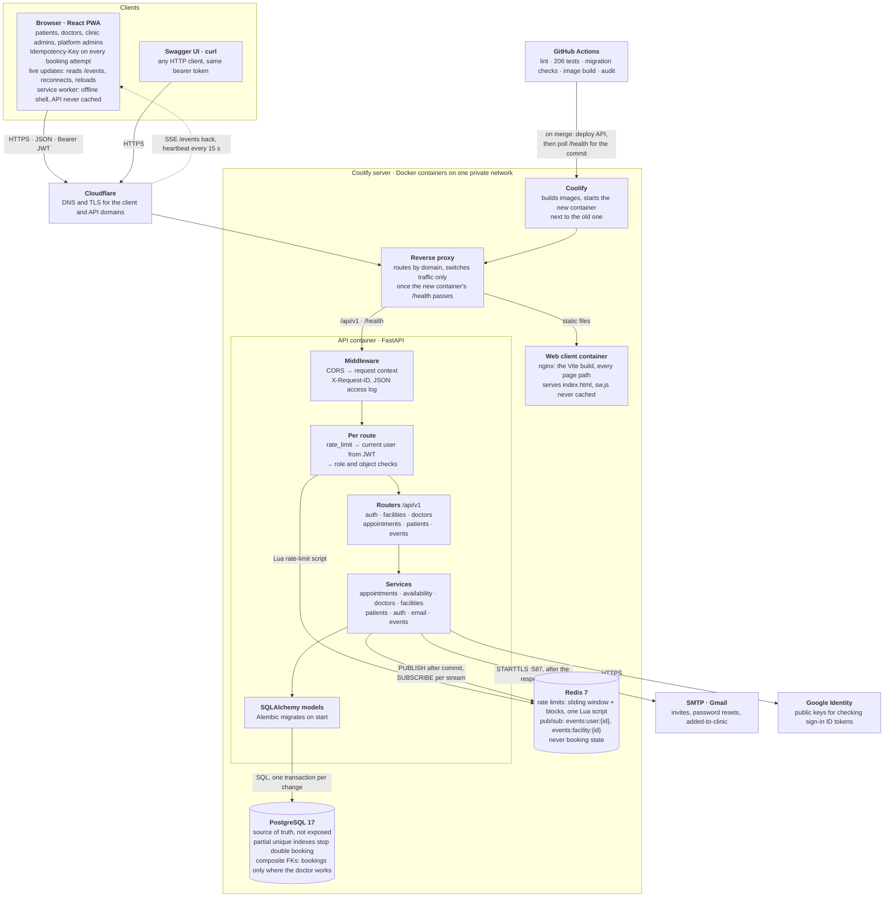
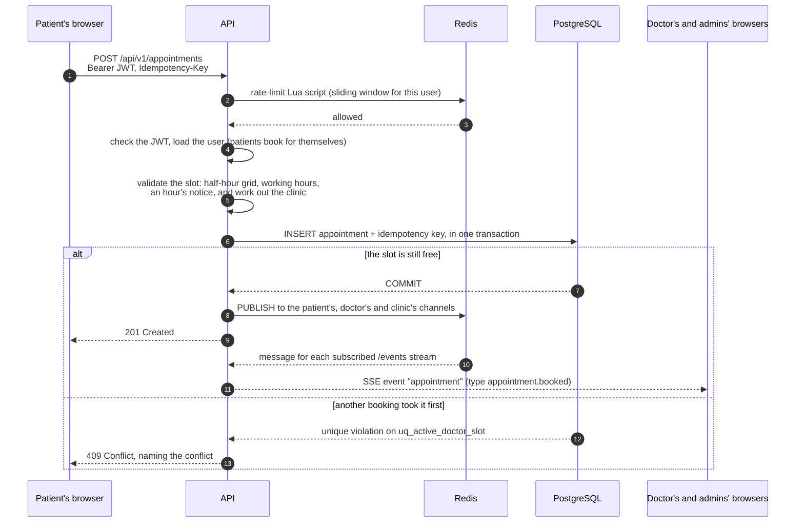

# Clinic Booking API

A REST API for booking 30-minute appointments with a clinic's doctors, built
with FastAPI, SQLAlchemy and PostgreSQL for the Savannah Informatics backend
assessment.

- **Live API:** <https://docconnectapi.mills.co.ke> (interactive docs at
  [`/docs`](https://docconnectapi.mills.co.ke/docs), health at
  [`/health`](https://docconnectapi.mills.co.ke/health))
- **Web client:** [savannah-client](https://github.com/mikemills254/savannah-client) (optional; the API stands on its own)
- **Architecture:** [docs/Architecture_Readme.md](docs/Architecture_Readme.md)
- **Deployment runbook:** [docs/Deployment.md](docs/Deployment.md)

Every API route is under `/api/v1`, so the brief's `POST /appointments` is
`POST /api/v1/appointments`. `/` and `/health` are outside the prefix.

---

## 1. System design

A summary of [docs/Architecture_Readme.md](docs/Architecture_Readme.md),
which covers the design in full: data model, key flows, security model,
decisions and known limitations.

### The problem in one sentence

Show each doctor's free 30-minute slots, let a patient take one, and make it
impossible for two people to end up holding the same slot, even when they ask
at the same moment.

### Components

A **modular monolith**: one deployable FastAPI app with clear layers inside,
deployed on a Coolify server next to the web client, PostgreSQL and Redis.



What happens when a patient books a slot, including the race the database
settles:



| Folder | Holds |
| --- | --- |
| `app/routes/` | One module per resource (`appointments`, `doctors`, `facilities`, `patients`, `auth`, `events`) |
| `app/services/` | Business rules, testable without HTTP. Raise `AppError`s that `main.py` maps to JSON errors |
| `app/models/` | SQLAlchemy models |
| `app/schemas/` | Pydantic request/response models (no database access) |
| `app/core/` | Config, security (JWT, password hashing), permissions, logging, rate limiting, Redis |
| `alembic/` | Versioned migrations; the only way the schema changes |
| `tests/` | Unit and integration tests against a real Postgres |

### Data model

| Table | What it is | Key constraints |
| --- | --- | --- |
| `facilities` | A clinic, with its IANA timezone | |
| `users` | Everyone, with exactly one role: `PATIENT`, `DOCTOR`, `FACILITY_ADMIN` or `SUPER_ADMIN` | Unique email (stored lowercased). Facility admins must have a `facility_id`; others must not (check constraint) |
| `doctor_facilities` | A doctor working at a clinic; a doctor can work at several | Primary key (doctor, clinic). Deactivated rather than deleted, so history stays |
| `doctor_working_hours` | Recurring weekly periods at one clinic, e.g. Monday 09:00–12:00, in that clinic's local time | `end_time > start_time`; (doctor, clinic) must be a `doctor_facilities` row |
| `appointments` | A booking and its lifecycle (`BOOKED` → `CANCELLED`), with who booked it, who cancelled it and why | See below |
| `idempotency_keys` | Makes a booking safe to retry | Unique per user and key |

Appointments are never deleted: cancelling is a state change, so history and
the reason survive.

### How double booking is prevented

This is the requirement that matters most, so the database enforces it rather
than trusting a "check, then insert" in Python (two requests can both pass the
check before either inserts):

```sql
-- one active booking per doctor per slot
CREATE UNIQUE INDEX uq_active_doctor_slot  ON appointments (doctor_id, starts_at)               WHERE status = 'BOOKED';
-- a patient can't hold two bookings at the same time at one clinic
CREATE UNIQUE INDEX uq_active_patient_slot ON appointments (facility_id, patient_id, starts_at) WHERE status = 'BOOKED';
```

The service still validates first (working hours, half-hour grid, not in the
past, at least an hour ahead) so the common errors are clear. The index is the
final word: when it rejects a concurrent duplicate, the service rolls back and
returns **409** naming the conflict. Because the indexes only cover `BOOKED`
rows, cancelling frees the slot immediately. `tests/test_concurrency.py` fires
simultaneous bookings at the same slot and asserts exactly one succeeds.

### Availability is computed, not stored

Slots aren't rows. For a doctor and a date, the service takes their working
periods for that weekday, steps through them in 30 minutes of clinic-local
wall-clock time, and removes slots that are booked or less than an hour away.
It runs one query for working hours and one for that day's bookings.
Generating slots in local time, and storing instants as `TIMESTAMPTZ`, keeps
it correct across daylight-saving changes (tested with London's clock change
and UTC+14 Kiritimati).

### Key decisions and trade-offs

| Decision | Why | Trade-off |
| --- | --- | --- |
| Modular monolith | Simple to run, test and deploy at five doctors | Scales as one unit until a part needs splitting out |
| PostgreSQL partial unique indexes | Correct under concurrency without locks or queues | Assumes fixed, aligned 30-minute slots. Variable lengths would need an exclusion constraint on a time range |
| Slots computed on request | No table of future slots to generate and keep in sync | A little computation per request (measured: query count doesn't grow with doctors or bookings) |
| Facilities (multi-clinic) from the start | "We want to grow". A clinic id on doctors and appointments is cheap now and painful to retrofit | More concepts than a single clinic strictly needs |
| One role per account, doctors linked to clinics | Simple permission checks, while a doctor keeps one account and one diary across clinics | A facility admin runs one clinic; someone who is both doctor and admin needs two accounts |
| Idempotency keys on booking | A retried request after a dropped response must not book twice | One extra row per booking |
| Redis for rate limits and live events | Rate limits must be shared across instances; live updates must reach users on any instance | One more service to run. If Redis is down, booking still works: limits fail open and the live update is skipped |
| JWT bearer tokens, no refresh tokens | Stateless, enough for the scope | A stolen token is valid until it expires (60 minutes) |

### Beyond the brief

Built on the same core rules, mostly because a real clinic needs them:

- **Roles.**
  - Clinic admins manage their doctors, working hours and all of the clinic's appointments, and can book on a patient's behalf (phone or walk-in). Booking for someone new creates an account they claim via an invite.
  - Doctors manage their own hours and appointments.
  - Platform admins create clinics. The first account to sign up becomes the platform admin, so a new deployment needs no setup script.
- **Live updates.** `GET /api/v1/events` is a Server-Sent Events stream, published through Redis pub/sub after each change commits. When a patient books, the doctor and the clinic's admins see it within about 100 ms (measured end to end); patients see changes the clinic makes.
- **Doctors at several clinics.** One account, separate hours at each clinic. Appointments and hours reference `doctor_facilities`, so a doctor can only be booked or scheduled where they work; the one-booking-per-slot index spans clinics, so they're never booked in two places at once; and hours that overlap another clinic are refused, compared as real instants across time zones. `POST /appointments` is unchanged: the clinic is the one whose hours the slot falls in, or an optional `facility_id`. Removing a doctor from one clinic leaves their others.
- **Accounts by email.** New staff, and patients a clinic books in, are emailed a one-use invite (patients see their visit in it). `POST /auth/forgot-password` emails a 30-minute reset link and answers the same whether or not the account exists; each link works once because it carries a digest of the password hash it was issued against. Emails go out after the response, so a slow mail server never delays a request.
- **Operations.**
  - Structured JSON logs with a request id on every line, returned as `X-Request-ID`.
  - Rate limiting, with tighter limits on login and sign-up.
  - `/health` checks the database and Redis and reports the deployed commit.

---

## 2. API

Full, interactive documentation is generated at `/docs` (Swagger) and
`/redoc`. The brief's endpoints:

| Brief | Endpoint | Behaviour |
| --- | --- | --- |
| Book a slot | `POST /api/v1/appointments` `{doctor_id, starts_at}` | **201** with the appointment. **400** off the half-hour grid, outside working hours, in the past or under an hour away. **404** unknown or inactive doctor. **409** slot taken, or the patient is already booked then. **422** malformed body (e.g. no UTC offset). Optional `Idempotency-Key` header makes retries safe |
| Availability | `GET /api/v1/doctors/{id}/availability?date=YYYY-MM-DD` | Free slots on that clinic-local date, in clinic time. **404** unknown doctor, **422** missing or invalid date |
| Cancel | `PATCH /api/v1/appointments/{id}/cancel` `{reason}` | **200** with the cancelled appointment; the slot is bookable again. **409** already cancelled or already started. **422** missing or blank reason. **404** not yours |
| Reschedule | `PATCH /api/v1/appointments/{id}/reschedule` `{starts_at}` | **200**; the old slot is freed in the same transaction. The new slot is validated exactly as a booking. **409** if cancelled, started or the new slot is taken |
| Bonus: upcoming | `GET /api/v1/patients/{id}/appointments` | Booked appointments that haven't ended, soonest first. The patient sees all of theirs; a clinic admin those at their clinic; a doctor those with them. **404** for anyone else |
| Bonus: 1-hour rule | (booking and reschedule) | Slots less than an hour away are refused (**400**) and are not listed as available |

Errors always look like `{"detail": "..."}`, with the status codes above.
Validation errors (422) use FastAPI's standard list of field errors.

### Trying it

1. On a fresh deployment, the first `POST /api/v1/auth/register` (or Google
   sign-in) creates the **platform admin** (`SUPER_ADMIN`). Do this straight
   after deploying: whoever signs up first owns the platform. Each sign-up
   returns an `access_token`; send it as `Authorization: Bearer <token>`.
2. `POST /api/v1/auth/register` with `facility_name` and `timezone` creates a
   clinic and its admin (refused as the very first account, which must be the
   platform admin).
3. As that clinic admin:
   - `POST /api/v1/facilities/{id}/members` adds a doctor. The response includes an invite token; the doctor accepts it at `/auth/accept-invite`.
   - `PUT /api/v1/facilities/{id}/doctors/{doctor_id}/working-hours` sets the doctor's hours.
4. `POST /api/v1/auth/register` without a facility creates a patient, who can
   then check availability and book.

---

## 3. Running locally

You need Docker, and Python 3.13 for running the tests outside Docker.

```bash
cp .env.example .env          # fill in the passwords and JWT_SECRET_KEY
pip install -r requirements-dev.txt
task docker:dev               # Postgres, Redis, migrations, then the API with reload
```

The API is at <http://localhost:8000> (docs at `/docs`). `docker:dev` also
starts pgAdmin and Redis Commander; `task --list` shows every task.

Without Docker for the API itself (Postgres and Redis still need to be
running):

```bash
alembic upgrade head
task dev                      # uvicorn with reload
```

---

## 4. Tests

**206 tests, all passing, 89% coverage (branches included), about 30
seconds for the full run.** They run against PostgreSQL and Redis, not SQLite
or mocks: the double-booking guarantee lives in PostgreSQL's partial unique
indexes, so a test anywhere else would prove nothing.

### Running them

From this folder, with Postgres and Redis running (`task docker:dev` starts
both):

```bash
pytest                                  # all 206 tests
pytest --cov                            # with line and branch coverage
pytest tests/test_concurrency.py        # one file
pytest -k "overlap or timezone"         # tests whose name matches
pytest -x -q                            # stop at the first failure
```

There's nothing else to set up. [tests/conftest.py](tests/conftest.py):

- creates a database named after `DATABASE_URL`'s with `_test` on the end (or
  uses `TEST_DATABASE_URL`) and migrates it with Alembic. It refuses any
  database whose name doesn't end in `_test`, because the concurrency tests
  empty every table;
- uses Redis database 15, emptied before each test that makes requests, so
  rate-limit counts don't carry over;
- catches every email in an `outbox` fixture, so nothing is sent.

### How the suite is built

- **The real schema.** The test database is built by the same migrations as
  production, so the indexes and composite foreign keys under test are the
  ones that ship.
- **Every test starts clean.** Each test runs in a transaction that is rolled
  back afterwards; its own commits are savepoints. The concurrency tests need
  real commits on separate connections, so they truncate instead.
- **Emails rendered, never sent.** The `outbox` fixture renders each email's
  real template, so a broken template fails a test. The reset and invite
  tests follow the link in the email, the way a user would.
- **Dates that don't go stale.** Bookings are made a week ahead in the
  clinic's time zone, so the suite passes on any day. Clock changes are tested
  on London's fixed dates, and the clock is frozen to check "today" in
  `Pacific/Kiritimati` (UTC+14), whose date runs ahead of UTC's.
- **Query counts checked.** A `count_queries` fixture asserts the clinic
  availability endpoints run the same number of queries however many doctors,
  bookings or clinics there are.
- **Redis failures tested.** Redis is made to fail on purpose to check that
  bookings still go through, rate limits let requests in, and the live update
  is skipped.

### What each file proves

| File | Tests | What it proves |
| --- | ---: | --- |
| `test_concurrency.py` | 3 | Two bookings for one slot, released together on separate connections: exactly one wins. A booking double-submitted with one `Idempotency-Key` is stored once. Two simultaneous first sign-ups make exactly one platform admin. |
| `test_booking.py` | 20 | Every booking rule: the half-hour grid, working hours, the past, one hour's notice, a taken slot, a patient's own clash, a cancelled slot freed, deactivated doctors and clinics. Idempotency keys are per user, can't be reused for another booking, and aren't used up by a failure. |
| `test_cancel_reschedule.py` | 16 | Who cancelled and why is recorded. Started or cancelled visits can't be changed. A new time is validated like a booking and frees the old slot. Only the patient, their doctor and their clinic's admins can act; anyone else gets a 404. |
| `test_availability_unit.py` | 9 | Slot arithmetic with no database: 30-minute steps, periods that don't divide evenly, times a spring-forward change skips, and a slot exactly an hour away versus one sooner. |
| `test_facility_availability.py` | 26 | The clinic's 14-day view matches the per-doctor endpoint for every doctor and date, finds the next free slot, rejects bad ranges, and runs a fixed number of queries. |
| `test_multi_clinic.py` | 24 | One doctor at two clinics: the clinic is worked out from the hours, one booking blocks that time everywhere, overlapping hours are refused across time zones, and each clinic sees only its own hours and appointments. |
| `test_api.py` | 23 | The HTTP contract for booking, availability, cancel, reschedule and a patient's appointments: 201, 400, 401, 404, 409 and 422 with their bodies. |
| `test_auth.py` | 14 | The first account (by email or Google) becomes the platform admin and can't register a clinic; later sign-ups are patients. Sign-up, sign-in and `/auth/me` list the right clinics for each role, loaded with the user in one query. |
| `test_emails.py` | 21 | Invite and reset emails are sent with working links. A reset link works once and expires, and an unknown address gets the same reply. A failed send is logged without the address. |
| `test_rate_limit.py` | 18 | The sliding window, blocks that grow up to 30 minutes, concurrent requests that can't slip past the limit, and login and invite guessing. Redis never holds an email or IP. |
| `test_events.py` | 12 | Live updates reach the patient, doctor and clinic involved and nobody else. Nothing is published when nothing changed, and a booking succeeds with Redis down. |
| `test_logging.py` | 14 | A request id on every response and log line, one access line per request, no emails in logs, and unhandled errors as a 500 carrying the id. |
| `test_config.py` | 6 | Settings from the environment: hosting providers' database URLs, CORS origins, the deployed commit. |

Test names are written as sentences
(`test_one_booking_blocks_the_same_time_at_every_facility`), so
`pytest --collect-only -q` reads as a list of the system's rules. The web
client's `/docs` page lists every one of them by file.

---

## 5. CI/CD

GitHub Actions ([.github/workflows/ci-cd.yml](.github/workflows/ci-cd.yml)),
deploying to [Coolify](https://coolify.io) on my own server.

- **Every pull request** runs five jobs in parallel:
  - **Lint:** `ruff check` and `ruff format --check`.
  - **Tests:** the full suite against Postgres 17 and Redis 7 service containers, with coverage. The build fails if coverage drops below 85%.
  - **Migrations:** one Alembic head, upgrade from empty, the models match the migrations, then downgrade to base and upgrade again.
  - **Docker image:** the production image builds.
  - **Audit:** `pip-audit` on the dependencies.
- **Merging into `master`** runs the same checks, then the **deploy** job:
  1. It calls Coolify's deploy API.
  2. Coolify builds the image and starts the new container, which applies migrations on start.
  3. Traffic switches over only once `/health` passes.
  4. The job then polls `/health` until it reports this commit, so a failed deploy fails the pipeline.
- Only `master` deploys. Other branches and PRs only run the checks.

Setup, required secrets and rollback are in
[docs/Deployment.md](docs/Deployment.md).

---

## 6. Decisions on ambiguous requirements

- **One clinic or many?** Many (each with its own timezone), with the brief's
  single clinic as the simplest case. See the trade-off table.
- **Who is the patient when booking?** The signed-in user. The API never
  accepts a `patient_id` from the client for self-booking, so no one can book
  as someone else.
- **Cancellation reason** is required (1–500 characters) and stored with who
  cancelled. Cancelling an appointment that has already started is refused.
- **Repeated cancellation** returns **409** and changes nothing.
- **Rescheduling** keeps the same doctor (moving to another doctor is a new
  booking). Moving to the time it already has is a no-op 200, so retries are
  safe.
- **The 1-hour rule** applies to everyone, including clinic staff booking a
  walk-in, so availability and booking always agree. Exactly one hour ahead is
  allowed.
- **"Upcoming"** includes an appointment in progress (not yet ended).
- **Times** are accepted with any UTC offset, stored as UTC instants, and
  returned in the clinic's local time with its offset.
- **API prefix:** routes are under `/api/v1` so a breaking change can ship as
  `/api/v2` alongside it.

---

## 7. AI reflection

**1. What did you use AI for across the four sections?**

Mostly as someone to think out loud with. Before writing any code I described
the clinic to Claude (Opus 5.5) and asked it to draft the architecture. Its
first schema had four tables: `doctors`, `patients`, `working_hours` and
`appointments`. It was a useful starting point, but I didn't keep it as it
was. Once I added sign-in I needed a `users` table with an email and a
password, while `doctors` and `patients` each kept their own name and contact
details. Every person would have existed twice, once as a login and once as a
doctor or patient, with nothing keeping the two copies in step. So I dropped
both tables. Every person is now one `users` row with a role (`PATIENT`,
`DOCTOR`, `FACILITY_ADMIN`, `SUPER_ADMIN`), and a check constraint makes sure
clinic admins, and only clinic admins, are tied to a clinic. Appointments
reference `users` for the doctor and the patient, and also for who booked and
who cancelled, which the draft had no way to record.

After that I used it the way I'd use a fast pair programmer: drafting
endpoints and service code from the rules I'd settled on, writing first
versions of tests, and helping me word the docs. I read and ran everything
it produced before it went in, and a fair amount of it changed on the way.

**2. One example where an AI suggestion improved your work. What did you
prompt it with?**

The best suggestion was in that first draft. I asked it for a schema for a
clinic booking system where a doctor can never be double booked, even when
two patients book at the same moment. The obvious approach is to check in the
service whether the slot is free and then insert, but two transactions can
both pass that check before either commits. Instead it put the rule in the
database: a partial unique index on `(doctor_id, starts_at) WHERE status =
'BOOKED'`. Two concurrent inserts can't both get past a unique index, and
because the index only covers booked rows, cancelling frees the slot with no
cleanup.

I kept the idea and built on it. The service still validates first so the
common errors read well, then catches the unique violation, rolls back and
returns a 409 naming the conflict. I added a second index so a patient can't
hold two bookings at the same time. `test_concurrency.py` releases
simultaneous bookings on separate database connections and asserts that
exactly one wins. That index is also why the whole suite runs on real
Postgres instead of SQLite: a test anywhere else wouldn't prove the
guarantee.

**3. One example where AI output was wrong or incomplete, and how you caught
it.**

The same draft had no idea of time zones, and that would only have shown up
in production. `working_hours` stored plain `TIME` values, so "Monday
09:00–12:00" didn't say whose 09:00. Appointments were `TIMESTAMPTZ` instants,
so turning hours into bookable slots meant assuming a zone, in practice the
server's, which is UTC on most hosts. A clinic in Nairobi would have offered
12:00–15:00 local time. I caught it while writing the availability logic,
because I couldn't do the conversion without choosing a zone.

To fix it, each clinic now stores an IANA timezone. Slots are generated in the
clinic's local time and only converted to UTC when stored. I tested the cases
where this breaks: London's spring-forward day, where a slot the clock skips
must not be offered, and `Pacific/Kiritimati` at UTC+14, where "today" isn't
UTC's today.

Reading the draft against the brief turned up two more gaps. There was nowhere
to store a cancellation reason, although the brief requires one. And nothing
stopped a patient booking two doctors for the same time.

**4. Two decisions you made without AI. Why did you trust your own judgment
there?**

**The data model.** Merging doctors and patients into one `users` table was
my call. Duplicated data isn't a style issue. It's a correctness bug waiting
to happen, because two copies of an email will eventually disagree. I knew
which identity mattered (the login) and made everything else reference it. I
accepted the trade-off knowingly: one role per account, so someone who is
both a doctor and a clinic admin needs two accounts.

**Hosting.** I started on Render and moved to Coolify on my own server. I
wanted the API, Postgres and Redis on one private network with the database
not exposed, and control over how deploys happen. A new container only gets
traffic once its `/health` passes, and CI keeps polling `/health` until it
reports the merged commit, so a failed deploy fails the pipeline. AI can list
hosting options, but cost, control and what I'm willing to operate are
trade-offs only I can weigh.
