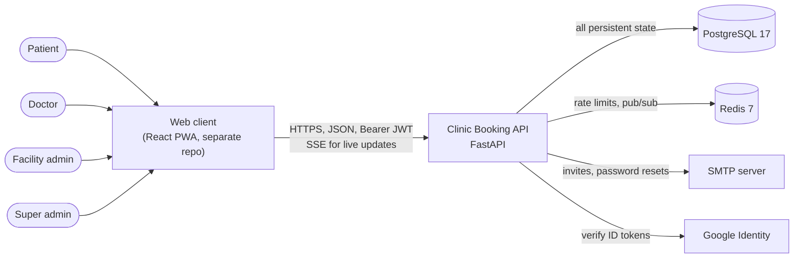
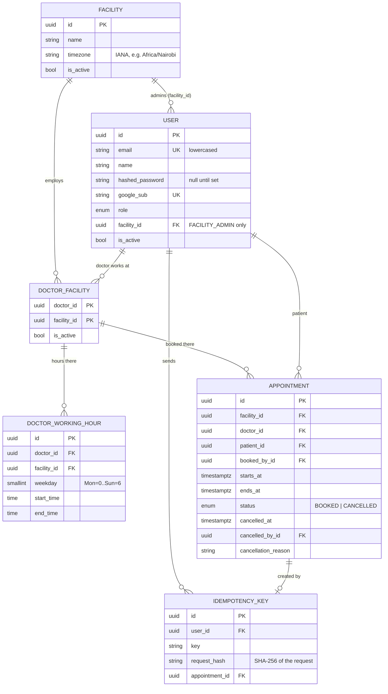
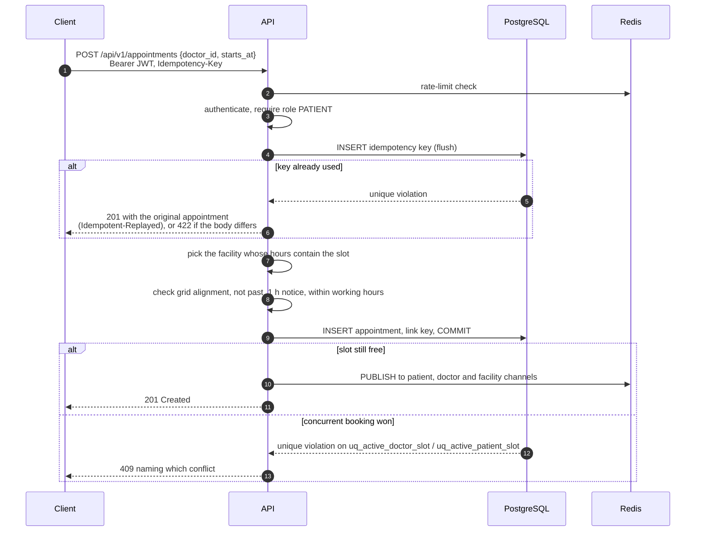

# Clinic Appointment Booking — Architecture

A REST API for booking 30-minute appointments with doctors across one or more clinics ("facilities"). Patients see free slots and book, cancel or reschedule. Facility admins manage doctors, working hours and the facility's appointments, and doctors manage their own hours and appointments. The rule that matters most is that no doctor, and no patient, can ever hold two active bookings for the same time, even when the requests arrive at the same moment.

The system is a **modular monolith**: one FastAPI application backed by PostgreSQL, with Redis for rate limiting and live updates.

## 1. Quality goals

Ranked; when two goals conflict, the higher one wins.

| # | Goal | What it means here |
|---|---|---|
| 1 | **Booking correctness** | Two active bookings never overlap for one doctor, or for one patient at one facility, under any concurrency. PostgreSQL enforces this, not application code alone. |
| 2 | **Privacy and authorization** | People see and change only the appointments they are entitled to. Resources they can't access look like they don't exist. |
| 3 | **Correct time handling** | Slots follow each facility's local wall clock, including across daylight-saving changes and across facilities in different timezones. |
| 4 | **Operational simplicity** | One deployable, two stateful services, zero-downtime deploys, and a health check that proves the deployed version. |
| 5 | **Changeability** | Business rules live in services that can be tested without HTTP. The schema changes only through migrations. |

## 2. Scope and rules

**In scope:** facilities with their own timezone; doctors working at one or more facilities; recurring weekly working hours; computed availability; booking (by a patient, or by a facility admin on a patient's behalf); cancellation with a reason; rescheduling; live updates; invites and password reset by email; Google sign-in.

**Out of scope:** payments, medical records, reminders, waiting lists, and schedule exceptions (leave, holidays).

**Business rules:**

- An appointment lasts 30 minutes and starts on the hour or half hour, in the facility's local time.
- A slot must be at least **one hour** ahead when it is booked or moved to. This applies to staff as well, so availability and booking always agree.
- A doctor's working hours are weekly periods (weekday, start, end) at a specific facility, in that facility's local time. Their hours at different facilities may not overlap.
- Each account has **exactly one role**: `PATIENT`, `DOCTOR`, `FACILITY_ADMIN` or `SUPER_ADMIN`.
- When a patient books, the patient is always the signed-in user. The API never accepts a `patient_id` for self-booking.
- Nothing is deleted. Appointments are cancelled, and people and facilities are deactivated.
- Times are accepted with any UTC offset, stored as UTC instants (`TIMESTAMPTZ`) and returned in the facility's local time with its offset.

## 3. System context



| Element | Role | If it is unavailable |
|---|---|---|
| **API** | All business logic. Stateless, so any number of instances can run behind the proxy. | — |
| **PostgreSQL** | Source of truth for every entity, and the final authority on booking conflicts. | The API reports unhealthy (`/health` returns 503) and requests fail. |
| **Redis** | Shared rate-limit counters and pub/sub for live events. Never holds booking state. | Booking keeps working. Rate limits let requests through, and live events are skipped. |
| **SMTP** | Transactional email, sent after the response. | The failure is logged and the user can ask again (reissue invite, new reset link). |
| **Google Identity** | Public keys for checking Google sign-in tokens. | Google sign-in fails; password login still works. |

## 4. Inside the API

```text
HTTP request
  │  middleware: CORS → request context (X-Request-ID, access log)
  ▼
routes/        parse input, rate limit, authenticate, check facility permission, call a service
  ▼
services/      business rules and transactions; raise AppError, never HTTPException
  ▼
models/        SQLAlchemy entities; PostgreSQL constraints enforce the invariants
```

- **Routes are thin.** They pick the dependencies (current user, facility access), call one service method, and shape the response with a Pydantic schema.
- **Services hold the rules** and own the transaction boundaries: each state change commits once. Services raise `AppError` subclasses (`InvalidRequestError` 400, `ForbiddenError` 403, `NotFoundError` 404, `ConflictError` 409), which `main.py` maps to `{"detail": "..."}`. This keeps services free of HTTP, so tests and scripts can call them directly.
- **No repository layer.** Services query SQLAlchemy directly. At this size a repository per model would add files without adding a useful abstraction.
- **Schemas never touch the database.**

```text
app/
├── main.py                     # App, middleware, AppError → JSON handler, /health
├── core/
│   ├── config.py               # Settings from environment variables
│   ├── security.py             # Password hashing; access, invite and password-reset tokens
│   ├── permissions.py          # Roles and facility-scoped permissions
│   ├── errors.py               # AppError hierarchy
│   ├── logging.py              # Structured logs with request_id / user_id
│   ├── rate_limit.py           # Redis sliding-window limits with escalating blocks
│   ├── redis.py                # Shared Redis clients
│   └── google.py               # Google ID-token verification
├── db/                         # Engine, session factory, declarative Base
├── models/
│   ├── user.py                 # Every account, with one role
│   ├── facility.py             # A clinic and its timezone
│   ├── doctor_facility.py      # Which doctors work at which facilities
│   ├── doctor_working_hours.py # Weekly working periods per doctor per facility
│   ├── appointment.py          # Bookings and their lifecycle
│   └── idempotent_key.py       # Makes booking safe to retry
├── schemas/                    # Pydantic request/response models
├── services/
│   ├── appointments.py         # Book, cancel, reschedule, list
│   ├── availability.py         # Slot arithmetic and schedule loading
│   ├── doctors.py              # Doctors, working hours, facility-wide availability
│   ├── facilities.py           # Facilities and staff membership
│   ├── patients.py             # Facility-side patient lookup and invites
│   ├── auth.py                 # Sign-up, login, Google, invites, password reset
│   ├── email.py                # Transactional email as background tasks
│   └── events.py               # Live updates over Redis pub/sub
├── routes/                     # One router per resource, mounted under /api/v1
├── dependencies/               # Current user, facility access, DB session per request
└── templates/email/            # HTML email templates
alembic/                        # Migrations: the only way the schema changes
tests/                          # Against real PostgreSQL and Redis
```

## 5. Data model



### Invariants the database enforces

| Constraint | Guarantees |
|---|---|
| `uq_active_doctor_slot`: unique `(doctor_id, starts_at)` where `status = 'BOOKED'` | A doctor has at most one active booking per slot, across **all** facilities |
| `uq_active_patient_slot`: unique `(facility_id, patient_id, starts_at)` where `status = 'BOOKED'` | A patient can't hold two bookings at the same time at one facility |
| `fk_appointment_doctor_in_facility`: `(doctor_id, facility_id)` → `doctor_facilities` | A doctor can only be booked where they work |
| `fk_working_hours_doctor_in_facility`: same shape | A doctor only has hours where they work |
| `ck_appointment_valid_period`, `ck_working_hours_valid_period` | End after start |
| `ck_working_hours_weekday` | Weekday is 0–6 |
| `ck_user_admin_has_facility` | A user has a `facility_id` if and only if they are a `FACILITY_ADMIN` |
| `uq_idempotency_user_key`: unique `(user_id, key)` | Two requests with one Idempotency-Key can't both book |
| Unique `users.email`, `users.google_sub` | One account per address and per Google account |
| Every foreign key is `ON DELETE RESTRICT` | History can't be lost through cascading deletes |

Because the partial unique indexes cover only `BOOKED` rows, a cancelled appointment stays in the table and its slot can immediately be booked again.

**Supporting indexes:** `appointments (patient_id, starts_at)` for a patient's history, `appointments (facility_id, starts_at)` for a facility's calendar, `doctor_working_hours (doctor_id, weekday)` and `(facility_id, doctor_id)` for schedule lookups, and `doctor_facilities (facility_id)`.

## 6. Key flows

### 6.1 Availability

Slots are computed on request, never stored.

1. Load the doctor's working periods at the facility for the date's weekday.
2. Step through each period in 30-minute increments of **local wall-clock time**: 09:00–12:00 gives 09:00, 09:30, …, 11:30, whatever that day's UTC offset is. Wall times that don't exist that day (a spring-forward gap) are skipped.
3. Remove slots that start less than an hour from now.
4. Remove slots with an active booking for that doctor at **any** facility.

`GET /doctors/{id}/availability?date=` returns one day. `GET /facilities/{id}/availability` returns every bookable doctor's free slots over a range of days (14 by default, up to 31), with a count per day and the next free slot. Both use the same `Schedules` object, which loads working hours and bookings in **two queries however many doctors or days**; tests assert the query count.

Availability is a snapshot, not a reservation. Booking revalidates everything, and the database decides any race.

### 6.2 Booking



- **The checks before the insert exist only to give clear errors.** Correctness comes from the partial unique indexes. The service maps the violated constraint's name to `SlotTakenError` or `PatientAlreadyBookedError`, and re-raises any other integrity error.
- **Idempotency.** The key is claimed in the same transaction as the booking. A concurrent duplicate waits on the unique index, then replays the committed booking. A failed booking rolls back its key, so a retry starts fresh. A key reused with a different request body gets 422.
- **Which facility.** If a doctor works at several facilities, the facility is the one whose hours contain the slot, or the one named by the optional `facility_id`.
- **Booking on a patient's behalf.** `POST /facilities/{id}/appointments` lets a facility admin book by the patient's email. An account is created if none exists (kept only if the booking succeeds), and the patient is emailed an invite. It goes through the same `_insert` path, so the same checks and constraints apply.

### 6.3 Cancel and reschedule

Both start with `SELECT … FOR UPDATE` on the appointment row, so concurrent changes to one appointment run one after the other.

- **Cancel** (`PATCH /appointments/{id}/cancel`, with a required reason): allowed for the patient, the appointment's doctor, or an admin of its facility. It sets `CANCELLED`, `cancelled_at`, `cancelled_by_id` and `cancellation_reason`. Cancelling an appointment that is already cancelled, or has already started, returns 409 and changes nothing.
- **Reschedule** (`PATCH /appointments/{id}/reschedule`): same doctor and facility. The new time is validated exactly like a new booking. The **same row** is updated, so the old slot is freed and the new one taken in a single commit: a failure leaves the original appointment untouched. Moving to the current time is a no-op 200, so a retry is safe.

### 6.4 Working hours

`PUT /facilities/{id}/doctors/{doctor_id}/working-hours` replaces a doctor's whole weekly schedule at one facility. Admins can set any doctor's hours; a doctor can set only their own.

- The doctor's `users` row is locked first, so two replacements for the same doctor, at any facility, run one at a time and each sees the other's result.
- The new hours are compared with the doctor's hours at their other active facilities **as real UTC instants over the coming week**, because weekday numbers alone can't compare facilities in different timezones. An overlap returns 409. Only the doctor is told which other facility clashes; an admin is not told where else the doctor works.
- Existing appointments are kept even if they fall outside the new hours.

### 6.5 Live updates

`GET /api/v1/events` is a Server-Sent Events stream.

- After a booking, cancellation or reschedule **commits**, the service publishes the appointment to Redis channels: `events:user:{patient_id}`, `events:user:{doctor_id}` and `events:facility:{facility_id}`.
- Each stream subscribes to what its user may read: patients and doctors to their own channel, facility admins to their facility's. Super admins get 403, because they don't see bookings.
- A message published on one API instance therefore reaches clients connected to any other.
- Delivery is **best effort**. The stream sends `ready` once it is subscribed, and clients reload their data whenever they (re)connect, so a missed event costs at most one reload. A heartbeat every 15 s keeps proxies from closing idle streams. The stream ends when the access token expires.
- The token is sent in the `Authorization` header (the client uses `fetch`), never in the URL.

### 6.6 Accounts

| Flow | Behaviour |
|---|---|
| First account | The first account to sign up (by email or Google) becomes the `SUPER_ADMIN`, so a new deployment needs no setup script. A transaction-scoped advisory lock means two simultaneous first sign-ups can't both get the role. A facility sign-up can't be the first account. |
| Patient sign-up | `POST /auth/register` |
| Facility sign-up | `POST /auth/register` with `facility_name` and `timezone` creates the facility and its admin in one transaction |
| Staff | An admin adds a doctor or admin by email (`POST /facilities/{id}/members`). New accounts get a 72-hour invite to set a password. A doctor already working elsewhere is linked to this facility and keeps their account. |
| Google sign-in | Verifies the ID token, links the account with the same email on first use, or creates a patient |
| Password reset | Emails a 30-minute link. The reply is identical whether or not the account exists. The token carries a digest of the current password hash, so it works once, and older links stop working once a newer one is used. |
| Removing staff | An admin's account is deactivated. A doctor is deactivated at this facility only, and their account is deactivated when they have no active facility left. History stays. |

## 7. Security model

**Authentication.**

- HS256 JWT bearer tokens that expire after 60 minutes, with no refresh tokens. Every request reloads the user, so a deactivated account is refused immediately.
- Passwords are hashed with Argon2 (`pwdlib`).
- Auth uses bearer tokens, not cookies, so CORS doesn't allow credentials and CSRF doesn't apply.

**Authorization** has two layers:

1. **Facility permissions** (`core/permissions.py`). A role grants permissions only at the facility the user works at.

   | Permission | Facility admin | Doctor | Super admin |
   |---|:-:|:-:|:-:|
   | Manage members | ✓ | | ✓ (any facility) |
   | Manage any doctor's schedule | ✓ | | |
   | Manage own schedule | ✓ | ✓ | |
   | View / cancel any appointment | ✓ | | |
   | View / cancel own appointments | ✓ | ✓ | |
   | Book for a patient, look up patients | ✓ | | |

   Patients need no facility permission to book, view or cancel their own appointments.

2. **Object checks in services.** `_OWN` permissions are checked against the record (the appointment is with *this* doctor). An appointment, patient or deactivated facility the caller can't access returns **404, not 403**, so ids can't be probed.

**Rate limiting** (Redis, a sliding window, atomic across instances via one Lua script). Going over a limit blocks the caller for 1, 5, 15, then 30 minutes. Redis keys hold hashes, never emails or IPs.

| Policy | Limit |
|---|---|
| All API routes, per user (per IP when signed out) | 300 / min |
| Login, per IP + email / per IP | 5 / min, 20 / min |
| Register | 5 / 10 min |
| Google login | 10 / min |
| Accept invite, reset password | 5 / min |
| Forgot password, per IP / per email | 5 / 10 min, 3 / 15 min |

**Data handling.** Logs carry ids, never names, emails, tokens or cancellation reasons. Secrets come only from environment variables. The production database and Redis are not exposed to the internet. The container runs as an unprivileged user.

## 8. Operations

- **Configuration:** environment variables via `pydantic-settings` (`DATABASE_URL`, `REDIS_URL`, `JWT_SECRET_KEY`, mail settings, `FRONTEND_URL`, `CORS_ORIGINS`, `LOG_FORMAT`, …). See `.env.example`.
- **Logging:** one JSON object per line on stdout. Every line logged during a request carries `request_id` (also returned as `X-Request-ID`) and, once known, `user_id`. Domain events are logged as `appointment.booked`, `appointment.cancelled`, `appointment.rescheduled`, `appointment.conflict` and `appointment.replayed`.
- **Health:** `GET /health` checks PostgreSQL and Redis, returns 503 if either is down, and reports the deployed commit. The Docker `HEALTHCHECK` and the host both use it. On startup the API exits immediately if it can't reach either service.
- **Deployment:** Docker on a Coolify server.
  - The new container starts alongside the old one, and traffic switches only once `/health` passes.
  - Migrations run on start (`MIGRATE_ON_START`). If a migration fails, the new container exits and the old version keeps serving.
  - On shutdown, open event streams are closed after 5 s, and clients reconnect to the new container.
  - See [Deployment.md](Deployment.md).
- **CI/CD** (GitHub Actions): lint and format check; tests against PostgreSQL 17 and Redis 7, with coverage required to stay at or above 85%; migration checks (a single head, upgrade from empty, models matching migrations, downgrade and upgrade again); a production image build; `pip-audit`. Merging to `master` deploys, then waits until `/health` reports the new commit.

## 9. Testing approach

Tests run against real PostgreSQL and Redis, because the main guarantees are PostgreSQL's partial indexes, composite foreign keys and row locks, so a test against SQLite or mocks would prove nothing. The test database is built by the production migrations.

- **Concurrency:** simultaneous bookings for one slot on separate connections; exactly one succeeds.
- **Time:** DST transitions (London) and a UTC+14 zone (Kiritimati), with a frozen clock.
- **Performance shape:** the availability endpoints are asserted to run a fixed number of queries, however many doctors, bookings or facilities there are.
- **Failure:** Redis made to fail on purpose; bookings still succeed.

The per-file breakdown is in the [README](../README.md#4-tests).

## 10. Architecture decisions

| Decision | Alternatives considered | Why this one | Consequence |
|---|---|---|---|
| Modular monolith | Microservices | One team, one domain, small scale; modules already separate concerns | Scales as a unit; a module can be split out later along existing service boundaries |
| Partial unique indexes prevent double booking | Check-then-insert in code; advisory locks; `SERIALIZABLE` transactions; a range exclusion constraint | Correct under any concurrency, with no locks held while validating, and the cheapest option for fixed aligned slots | Assumes fixed 30-minute aligned slots (see §12) |
| Slots computed on request | A table of pre-generated slots | Nothing to generate or keep in sync when hours change | Some computation per request, bounded at two queries |
| Facilities, and doctors at several facilities | A single implicit clinic | A facility id is cheap to add now and expensive to retrofit; doctors commonly work at more than one clinic | More concepts; cross-facility overlap checks are needed |
| One `users` table, one role per account | Separate patient/doctor tables; many-to-many role memberships | One login, token and ownership path; permission checks stay simple | Someone who is both a doctor and an admin needs two accounts; an admin runs one facility |
| Idempotency key claimed in the booking transaction | Client-side dedupe only; a Redis-held key | Retrying after a dropped response can never book twice, even when the retries run concurrently | One extra row per keyed booking |
| Row locks for cancel, reschedule and hours replacement | Optimistic version columns | These are rare, short writes; locking makes the "already cancelled" and overlap checks race-free | Concurrent edits to one appointment or doctor wait briefly |
| Redis for rate limits and pub/sub, failing open | In-process limits; Postgres `LISTEN/NOTIFY` | Limits and events must work across instances; Redis is simple and fast at both | One more service. Its outage weakens limits and drops live events but never blocks booking |
| SSE for live updates | WebSockets; polling | Updates only flow server → client; SSE is plain HTTP and works through proxies | Clients must handle reconnects and reload on `ready` |
| JWT access tokens without refresh | Server sessions; refresh tokens | Stateless and enough for this scope | A stolen token stays valid for up to 60 minutes |
| Soft state (cancel, deactivate), `RESTRICT` foreign keys | Hard deletes | Audit trail and history are kept | Tables only grow |
| UUID primary keys | Serial integers | Ids don't reveal record counts and can't be enumerated | Larger indexes |
| API under `/api/v1` | Unversioned paths | A breaking change can ship as `/api/v2` alongside | Longer URLs |

## 11. Risks and known limitations

| Item | Impact | Mitigation / next step |
|---|---|---|
| First sign-up becomes the super admin | On a fresh deployment, whoever signs up first owns the platform | Create the owner account immediately after the first deploy, before the URL is shared |
| No schedule exceptions (leave, holidays) | Bookings stay on days a doctor is absent | Add a `schedule_exceptions` table, subtracted in availability and checked in booking; notify affected patients |
| Changing hours doesn't touch existing bookings | Appointments can remain outside the new hours | Report affected appointments to the admin when hours are saved |
| Emails sent as in-process background tasks | An email is lost if the process dies right after responding; there is no retry | Transactional outbox and a worker, when delivery must be guaranteed |
| Live events are best effort | Missed while Redis is down | Clients already reload on reconnect; add an outbox if events must be durable |
| `idempotency_keys` never pruned | The table grows forever | Periodically delete keys older than a retention window (`created_at` is indexed) |
| No metrics endpoint | Rates and latencies come only from logs | Add Prometheus metrics for booking outcomes, conflicts and latency |
| No refresh tokens or revocation list | A stolen token stays usable until it expires | Shorter-lived access tokens with refresh tokens, if the threat model requires it |
| Backups and restore are not documented | Data loss risk | Schedule PostgreSQL backups on the host and document a tested restore |
| Single PostgreSQL instance | A single point of failure | A managed or replicated Postgres when uptime requirements justify it |

## 12. Evolution

Changes to make when a specific need appears, not before:

- **Variable appointment lengths or unaligned starts:** replace `uq_active_doctor_slot` with an exclusion constraint on `tstzrange(starts_at, ends_at)` per doctor (`btree_gist`). The invariant (no overlapping active bookings) stays the same.
- **Reminders and notifications:** a transactional outbox written in the booking transaction, drained by a worker; Redis is already available as the queue.
- **More traffic:** the API is stateless and limits and events are shared through Redis, so more instances can be added behind the proxy. Then tune the connection pool, and cache facility availability, invalidated by the same appointment events.
- **Stronger tenant isolation:** PostgreSQL row-level security keyed on `facility_id`, as a second layer behind the service checks.
- **Splitting services:** only when a module needs independent deployment, scaling or ownership. Notifications are the most likely first candidate.
